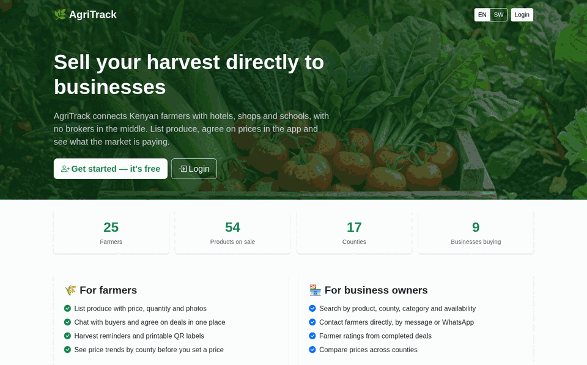
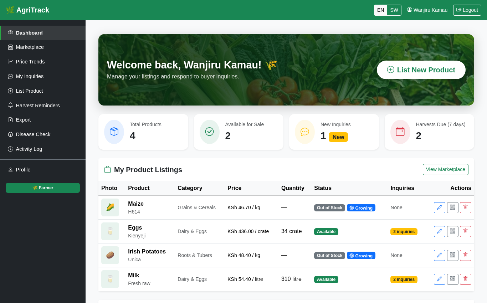
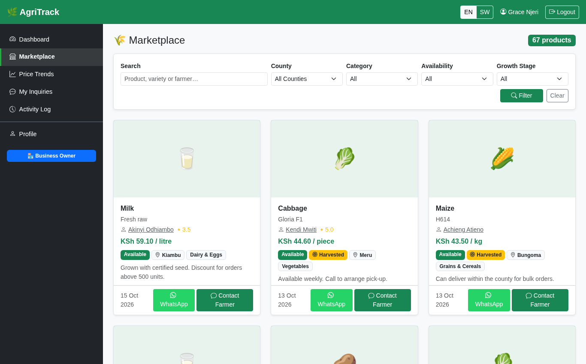
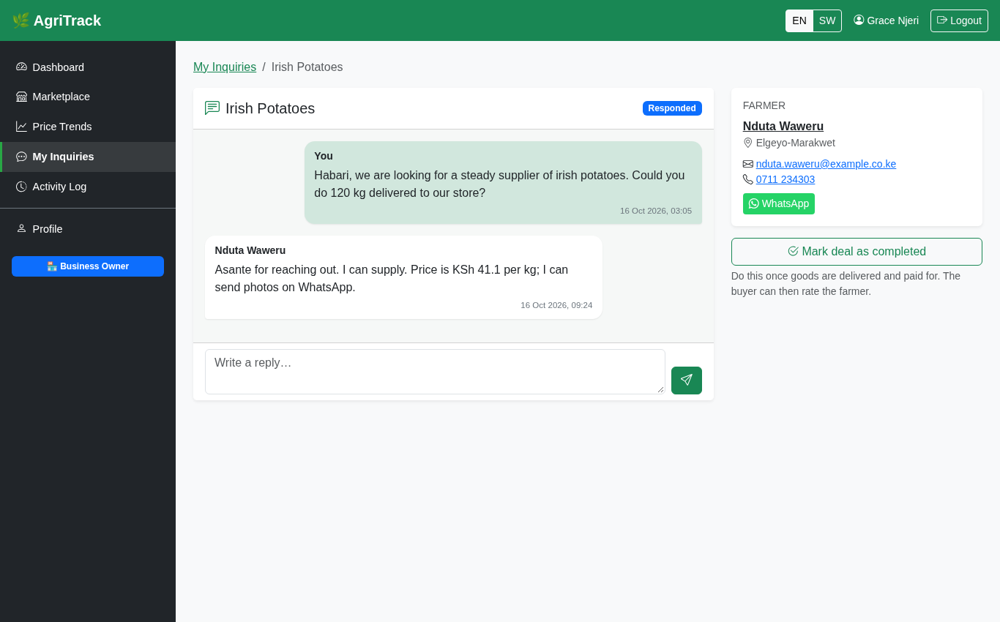
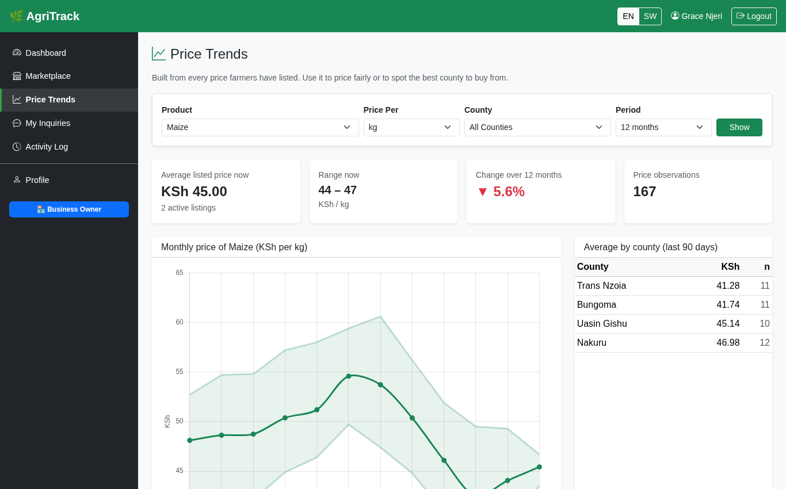
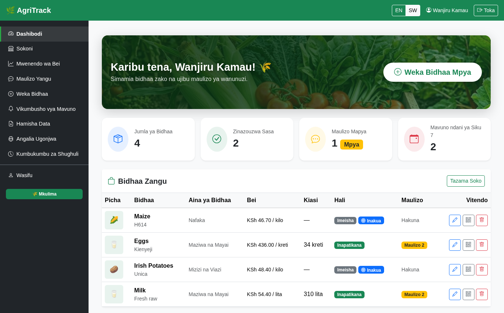
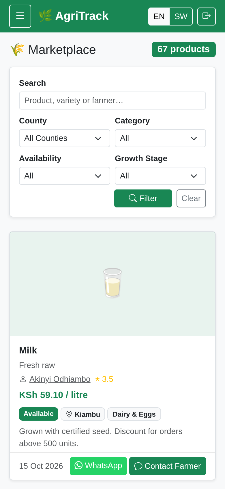
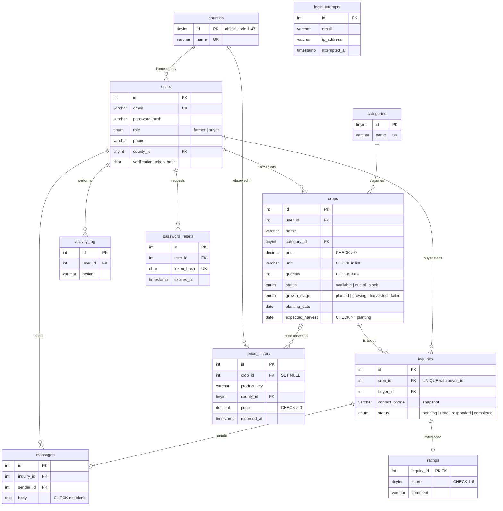

# 🌿 AgriTrack — a farmer-to-business marketplace for Kenya

[](https://github.com/f4zzie/agri_app/actions/workflows/ci.yml)


Smallholder farmers list produce; hotels, shops and schools buy directly from them, with no broker in the middle. Buyers and farmers agree deals in an in-app conversation (or on WhatsApp), rate each other after delivery, and see what the market is actually paying per county.

A normalised schema evolved through versioned migrations, with CHECK constraints, views, triggers, transactions and indexes justified by `EXPLAIN` measurements.



**Try it in one command** (Docker): `docker compose up --build`, then open <http://localhost:8080> and log in as
`farmer@agritrack.test` or `buyer@agritrack.test`, password `Demo@1234`.

---

## Contents

- [What I built](#what-i-built)
- [Features](#features)
- [Screenshots](#screenshots)
- [Database design](#database-design)
- [Getting started](#getting-started)
- [Testing and quality](#testing-and-quality)
- [Project structure](#project-structure)
- [Limitations and roadmap](#limitations-and-roadmap)

---

## What I built

agri_app is an agricultural application centered on farm-related data and workflows. It provides a simple interface for interacting with that information. The app is intended to make common agricultural tasks easier to carry out.

---

## Features

**For farmers**
- List produce with price (KES), unit, quantity, photo, variety, **availability** (available / out of stock) and an optional **growth stage** (planted / growing / harvested / failed) with planting and harvest dates.
- Conversations with buyers, a “mark deal completed” action, and an inbox with new / seen / responded / completed states.
- **Harvest reminders** for planted or growing crops due within 7 days (email when SMTP is configured).
- **Printable QR labels** linking to a public product page (QR generated in the browser).
- CSV and PDF export, activity log, and an honest disease-check page (photo + guide to common Kenyan crop problems; no fake diagnosis).

**For business owners**
- Marketplace search with filters for county, category, availability and growth stage.
- Contact a farmer in the app or with one tap on **WhatsApp**; rate the farmer after a completed deal.
- **Price trends**: monthly average/min/max per product and an average-by-county table, aggregated from a trigger-maintained price ledger.

**For everyone**
- Full **English / Kiswahili** UI (386 strings, completeness enforced by a test).
- **Installable PWA**: works on a phone's home screen; the listing form opens offline and keeps a draft until the connection returns.
- Optional **SMS notifications** via Africa's Talking for new inquiries and replies.
- Email verification, password reset, Google sign-in (all optional; the app degrades gracefully without them).

---

## Screenshots

| Farmer dashboard | Marketplace |
| --- | --- |
|  |  |
| **Conversation with rating** | **Price trends** |
|  |  |
| **Kiswahili** | **On a phone** |
|  |  |

More: [landing page](docs/screenshots/landing.png) · [buyer dashboard](docs/screenshots/dashboard-buyer.png) · [listing form](docs/screenshots/add-product.png) · [farmer profile](docs/screenshots/farmer-profile.png)

---

## Database design

### Entity-relationship diagram



### Migrations

The schema is built by eight forward-only migrations (`php bin/migrate.php`), so each design decision is visible as a step:

| # | Migration | What and why |
| --- | --- | --- |
| 001 | `init` | The original v1 schema, unchanged. |
| 002 | `lookup_tables` | Free-text `county`/`category` → foreign keys to `counties` (official codes 1–47) and `categories`. |
| 003 | `split_crop_status` | One ENUM mixed availability with growth stage, so filters and reminders never matched real listings. Split into `status` + `growth_stage`, converting existing rows. |
| 004 | `inquiry_threads` | Normalisation (below), `messages` table for replies, duplicate threads merged then `UNIQUE(crop_id, buyer_id)`, `ratings` table. |
| 005 | `price_history` | Append-only price ledger filled by `AFTER INSERT/UPDATE` triggers on `crops`. |
| 006 | `hash_tokens` | Reset/verification tokens stored as SHA-256 hashes; resets keyed by `user_id` FK. |
| 007 | `constraints_and_views` | Repairs violating rows, then adds CHECK constraints and three views. |
| 008 | `indexes` | Indexes matched to real query paths, with before/after evidence. |

### Normalisation

The v1 `inquiries` table copied `buyer_name` and `buyer_email` from `users` (an update anomaly: a renamed user left stale copies) and stored `farmer_id`, which is already determined by `crop_id → crops.user_id` (a transitive dependency). Migration 004 removes all three; names and the farmer are joined at read time, and the schema is in **3NF**.

Two columns look like duplication but are **deliberate snapshots**, documented in the migrations:
- `inquiries.contact_phone` — the number the buyer gave *for this deal*, which may differ from their profile phone.
- `price_history.product_key / unit / county_id` — what was true when a price was observed. It is a historical ledger, so it must not change when a listing is later edited or deleted (`crop_id` is `ON DELETE SET NULL`).

### Constraints, views, triggers, transactions

- **CHECK constraints**: price > 0, quantity ≥ 0, harvest date ≥ planting date, unit in an allowed list, non-blank names and messages, rating 1–5. The database rejects bad data even from manual SQL.
- **Views**: `v_marketplace` (listing + farmer, county, category), `v_farmer_ratings` (average and count per farmer), `v_inquiry_threads` (conversation, both parties, latest message, message count). Pages query these instead of repeating four-table joins.
- **Triggers**: `trg_crops_price_after_insert` / `_after_update` append to `price_history` only when a price is set or price/unit/name actually change. Single-statement bodies, so the migration files import in phpMyAdmin without `DELIMITER`.
- **Transactions**: opening a thread (inquiry + first message), replying (message + status), registration (user + log entry) and password reset (new hash + retiring every outstanding token) are atomic. `App\Inquiries` joins a caller's transaction instead of failing on a nested `BEGIN`.

### Indexes, with evidence

Every index matches a specific `WHERE`/`ORDER BY` in the code. `php tools/explain_demo.php` builds a scratch database with ~210k rows and records plans and median timings before and after migration 008 ([full output](docs/EXPLAIN.md)):

| Query | Index | Median time before → after |
| --- | --- | --- |
| Login rate limit | `(ip_address, attempted_at)` | 13.66 ms → 0.26 ms |
| Password-reset token lookup | `UNIQUE (token_hash)` | 6.79 ms → 0.22 ms |
| Buyer dashboard, newest available | `(status, created_at)` | 54.56 ms → 0.66 ms |
| Price trend for one product | `(product_key, unit, recorded_at)` | 24.56 ms → 0.99 ms |
| Marketplace by county | *none added* | 2.48 ms → 2.68 ms |

A `(role, county_id)` index for the county filter was measured, showed no change in plan or time, and was left out. The write-up explains why the buyer dashboard's row *estimate* rises while its time falls.

---

## Getting started

### Option 1 — Docker (recommended)

```bash
git clone https://github.com/f4zzie/agri_app.git && cd agri_app
docker compose up --build
```

Open <http://localhost:8080>. On first start the container waits for MariaDB, applies all migrations and seeds demo data. Data and uploads persist in the `db_data` and `uploads` volumes; `docker compose down -v` resets everything.

To deploy, run the same compose file on any small VPS behind Caddy/nginx for HTTPS (change the passwords and `APP_URL` first), or deploy the Dockerfile to Render/Railway with a managed MySQL/MariaDB, the `DB_*`, `APP_URL` and `SEED_DEMO_DATA=1` variables, and a persistent disk at `/var/www/html/public/uploads`.

### Option 2 — XAMPP (or any PHP 8.1+ with MySQL/MariaDB)

1. Clone into `htdocs` (e.g. `C:\xampp\htdocs\agri_app`) and start Apache and MySQL.
2. `copy .env.example .env` (Windows) or `cp .env.example .env`, and check the `DB_*` values (XAMPP defaults: user `root`, empty password).
3. Create the schema and demo data:
   ```bash
   php bin/migrate.php
   php bin/seed.php
   ```
   (On Windows use `C:\xampp\php\php.exe` if `php` is not on your PATH.)
4. Optional: `composer install` enables email (PHPMailer) and PDF download (Dompdf). Without it the app still works; PDF export falls back to a printable page.
5. Open <http://localhost/agri_app>. The root `.htaccess` routes every request into `public/`, so `config.php`, `.env`, `migrations/` and `tools/` are never served.

### Demo accounts

| Role | Email | Password |
| --- | --- | --- |
| Farmer (Wanjiru Kamau, Nakuru) | `farmer@agritrack.test` | `Demo@1234` |
| Business owner (Grace Njeri) | `buyer@agritrack.test` | `Demo@1234` |

The seed also creates 23 more farmers, 7 more buyers, 59 conversations with ratings and 12 months of price history. It is deterministic and refuses to run on a non-empty database unless given `--force`.

### Configuration

All settings are environment variables (`.env` locally; real environment variables override it, e.g. in Docker). Only `DB_*` and `APP_URL` are required.

| Variables | Enables |
| --- | --- |
| `DB_HOST`, `DB_PORT`, `DB_NAME`, `DB_USER`, `DB_PASS`, `APP_URL` | Required |
| `SMTP_HOST`, `SMTP_PORT`, `SMTP_USER`, `SMTP_PASS` | Email verification, password reset, notifications. Without them, new accounts start verified. |
| `GOOGLE_CLIENT_ID`, `GOOGLE_CLIENT_SECRET`, `GOOGLE_REDIRECT_URI` | “Continue with Google” (button hidden otherwise) |
| `AT_USERNAME`, `AT_API_KEY`, `AT_SENDER_ID` | SMS via Africa's Talking (`AT_USERNAME=sandbox` for testing) |
| `DEMO_MODE=1` | Shows the demo logins on the landing and login pages |

---

## Testing and quality

```bash
composer test        # PHPUnit: 48 unit + 12 integration tests (integration needs a DB server)
composer analyse     # PHPStan, level 5
composer lint        # php -l on every file
tests/smoke.sh       # end-to-end over HTTP against a running server (see the script header)
php tools/explain_demo.php   # regenerate docs/EXPLAIN.md
```

- **Unit tests** cover upload validation (including the original `shell.php`-as-GIF exploit), listing validation, CSRF, translations (Kiswahili must have exactly the English keys and matching placeholders), Kenyan phone normalisation, SMS request building, token hashing and the inquiry status rules.
- **Integration tests** run every migration on a throwaway `agri_app_test` database and check the CHECK constraints, triggers, views, cascades, transaction rollback and thread access control.
- **CI** (GitHub Actions) runs lint on PHP 8.1 and 8.3, PHPStan, PHPUnit against MariaDB 11.4, migrations + seed from an empty database, and the HTTP smoke test.

### Security

Uploads are stored under a random name with the extension taken from the detected MIME type (the original code kept the client's extension, allowing remote code execution), and `uploads/.htaccess` disables script execution. Other measures: prepared statements throughout, CSRF tokens on every form (including logout), `HttpOnly`/`SameSite` session cookies with id regeneration on login, login rate limiting per account and per IP, hashed one-time tokens, server-side role checks on every page, refusal of unverified Google emails, and baseline security headers.

---

## Project structure

```
public/          web root: one PHP file per page, CSS/JS, PWA files, uploads/
includes/        layout (header/footer), shared partials and view helpers
src/             classes: Upload, CropInput, Inquiries, Migrator, Token, Phone, Sms
config.php       env loading, DB connection, sessions, i18n, CSRF, mail helpers
lang/            en.php and sw.php
migrations/      001–008 SQL migrations
bin/             migrate.php, seed.php
tools/           explain_demo.php, generate_report.php
tests/           Unit/, Integration/, smoke.sh
docs/            EXPLAIN.md, screenshots/
docker/          entrypoint and Apache config
```

---

## Limitations and roadmap

- Disease check is not automated: it stores the photo and shows a guide; an image-recognition model could be added later.
- No in-app payment: deals are paid outside the app; M-Pesa (Daraja) deposits are the natural next step.
- SMS is unit-tested with a fake transport but has not been run against the live Africa's Talking API.
- Product names are free text, so price trends group by lower-cased name; a product reference table would make trends more robust.
